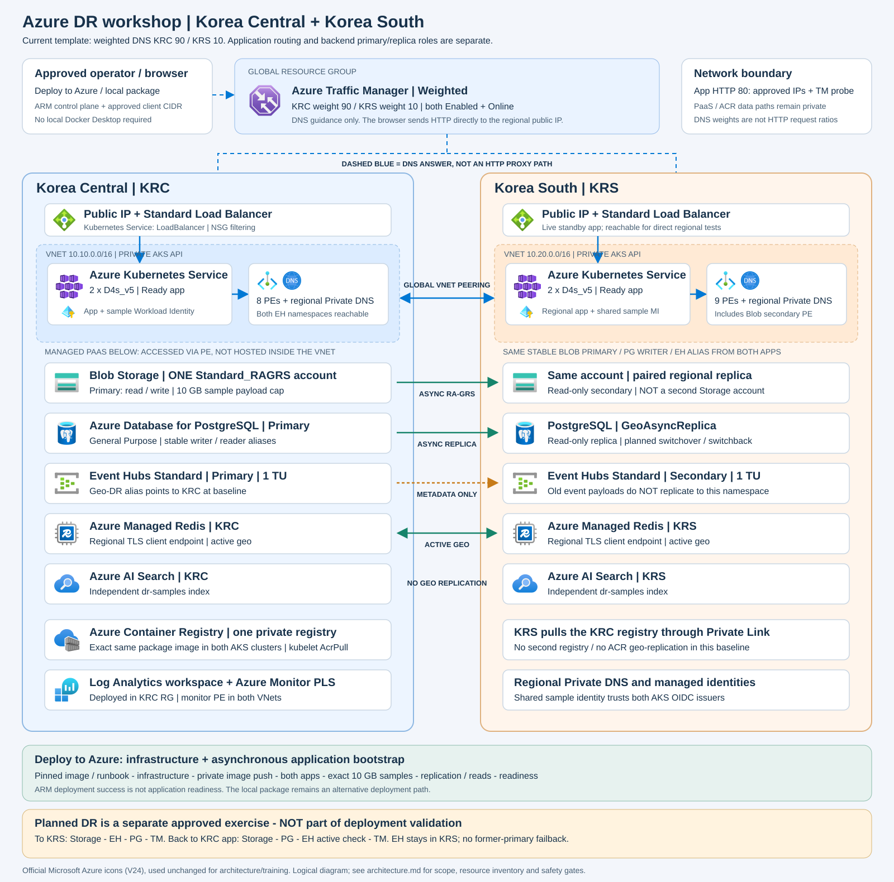

# Azure Portal 기반 DR 워크숍

GitHub의 **Deploy to Azure** 버튼에서 Azure 포털로 이동하여 리소스와 앱을 자동 배포하고,
앱 데이터 확인, Korea South 전환, Korea Central 원복, 리소스 정리를 순서대로 진행합니다.
역할별 문서를 나누지 않고 하나의 실습 순서를 사용합니다.

## 워크숍 아키텍처



평시에는 Traffic Manager가 **Weighted 라우팅으로 KRC 90 / KRS 10** 비율로 DNS 응답을 선택합니다.
DR 시 데이터 서비스 전환 후 KRC endpoint를 비활성화하여 KRS 앱으로만 안내합니다.
[서비스 구성과 전환 흐름 설명](workshop/README.md#워크숍-아키텍처)을 먼저 확인합니다.

## 시작하기

**[고객용 Step-by-Step 워크숍 시작](workshop/README.md)**

| 순서 | 실습 |
|---|---|
| 0 | [실행 환경과 Azure 로그인](workshop/00-environment.md) |
| 1 | [포털에서 리소스와 앱 배포](workshop/01-deploy.md) |
| 2 | [자동 배포 완료와 앱 접속](workshop/02-ready.md) |
| 3 | [앱 데이터와 샘플 복제 확인](workshop/03-application.md) |
| 4 | [포털 Failover와 Failback](workshop/04-dr-portal.md), [Bash 대안](workshop/04-dr.md) |
| 5 | [리소스 정리와 종료](workshop/05-cleanup.md) |

배포와 DR 역할 변경은 Azure 포털에서 수행할 수 있습니다. 설정 가져오기와 보조 운영 명령은
저장소 루트의 **Bash 터미널**에서 실행합니다. Bash DR 대안의 장시간 실행 환경은 첫 단계에 설명되어 있습니다.

## 필수 사전 단계: Resource Provider 등록

**Deploy to Azure 버튼을 누르기 전에 승인된 배포 구독에서 반드시 실행합니다.**
Azure Cloud Shell **Bash** 또는 Azure CLI가 설치된 Linux/WSL Bash를 사용합니다.
Cloud Shell은 로그인된 계정을 사용하며, 로컬 Bash에서는 먼저 `az login`을 실행합니다.
`YOUR-SUBSCRIPTION-ID`를 승인된 구독 ID로 바꾸고, 출력되는 계정·구독이 포털 배포 대상과 같은지 확인합니다.

구독 범위의 **Contributor/Owner 또는 각 Provider의 `/register/action` 권한**이 필요합니다.
RG 범위 권한만으로는 부족합니다. 이 권한은 템플릿의 role assignment/custom role 생성 권한과 별개입니다.
아래 목록은 현재 포털 기본 배포의 Provider와 AKS 노드의 간접 의존성인 `Microsoft.Compute`를 포함합니다.
포털에서 비활성화된 Budget의 `Microsoft.Consumption` 등 사용하지 않는 Provider는 일괄 등록하지 않습니다.

```bash
export SUBSCRIPTION_ID='YOUR-SUBSCRIPTION-ID'
(
	set -euo pipefail
	[[ -n "$SUBSCRIPTION_ID" && "$SUBSCRIPTION_ID" != 'YOUR-SUBSCRIPTION-ID' ]] || {
		printf 'STOP: Set the approved subscription ID first.\n' >&2
		exit 1
	}
	az account set --subscription "$SUBSCRIPTION_ID"
	az account show --query '{subscription:name,id:id,tenant:tenantId}' -o table

	providers=(
		Microsoft.Compute Microsoft.Network Microsoft.Storage
		Microsoft.ContainerService Microsoft.ContainerRegistry
		Microsoft.DBforPostgreSQL Microsoft.Cache Microsoft.Search Microsoft.EventHub
		Microsoft.ManagedIdentity Microsoft.OperationalInsights Microsoft.Insights
		Microsoft.Automation
	)
	for provider in "${providers[@]}"; do
		state="$(az provider show --subscription "$SUBSCRIPTION_ID" \
			--namespace "$provider" --query registrationState -o tsv)"
		case "$state" in
			Registered) printf '%s: Registered\n' "$provider"; continue ;;
			NotRegistered|Unregistered)
				az provider register --subscription "$SUBSCRIPTION_ID" --namespace "$provider" -o none ;;
			Registering) ;;
			*) printf 'STOP: %s has state %s\n' "$provider" "$state" >&2; exit 1 ;;
		esac

		deadline=$((SECONDS + 900))
		while true; do
			state="$(az provider show --subscription "$SUBSCRIPTION_ID" \
				--namespace "$provider" --query registrationState -o tsv)"
			case "$state" in
				Registered) printf '%s: Registered\n' "$provider"; break ;;
				Registering|NotRegistered|Unregistered) ;;
				*) printf 'STOP: %s has state %s\n' "$provider" "$state" >&2; exit 1 ;;
			esac
			if (( SECONDS >= deadline )); then
				printf 'STOP: %s registration timed out (%s).\n' "$provider" "$state" >&2
				exit 1
			fi
			printf '%s: %s; waiting...\n' "$provider" "$state"
			sleep 10
		done
	done
	printf 'PROVIDERS_READY: Use this same subscription in the deployment form.\n'
)
```

**모든 Provider가 `Registered`이고 마지막에 `PROVIDERS_READY`가 출력된 경우에만 배포 버튼으로 진행합니다.**
오류·권한 부족·시간 초과이면 중단하고 관리자에게 확인합니다. 등록은 구독 설정을 변경하지만
워크숍 리소스를 배포하거나 기존 Provider를 등록 해제하지 않습니다. 재실행 시 이미 등록된 항목은 건너뜁니다.

`Registering`은 지역별 등록 진행 상태로, 그 자체로 실패가 아닙니다. 이 수동 준비 절차는 보수적인
완료 기준으로 최종 `Registered`까지 Provider별 최대 15분간 대기합니다. 시간 초과 시 무조건 재등록하지 말고
관리자에게 Korea Central/Korea South 준비 상태를 확인합니다.

이미 `Registered`인 Provider에 새 리전 반영이 필요한 것으로 확인된 경우에만, 해당 namespace 하나를
지정해 재등록합니다. 모든 Provider를 매번 재등록하지 않습니다.

```bash
export PROVIDER_NAMESPACE='Microsoft.DBforPostgreSQL'
az provider register --subscription "$SUBSCRIPTION_ID" --namespace "$PROVIDER_NAMESPACE" --wait
az provider show --subscription "$SUBSCRIPTION_ID" --namespace "$PROVIDER_NAMESPACE" \
	--query '{provider:namespace,state:registrationState}' -o table
```

재등록은 API 버전 업그레이드가 아닙니다. 미지원 API 버전·리전·SKU, 할당량·정책·권한 오류는
등록만으로 해결되지 않으므로 해당 오류를 별도로 확인합니다.
[Microsoft의 Provider 등록·재등록 안내](https://learn.microsoft.com/azure/azure-resource-manager/management/resource-providers-and-types)를 참고합니다.

## 배포 버튼

위 **필수 사전 단계**에서 `PROVIDERS_READY`를 확인한 뒤, [보안 안내](../SECURITY.md)를 확인하고
이번 실습 전용의 새 prefix를 사용합니다.
기존 환경에 같은 prefix로 전체 템플릿을 재배포하지 않습니다. 배포 실패 시 오류와 현재 리소스 상태를
확인한 뒤 진행하며, 보호 설정을 해제하거나 오류를 우회하지 않습니다.

[](https://portal.azure.com/#view/Microsoft_Azure_CreateUIDef/CustomDeploymentBlade/uri/https%3A%2F%2Fraw.githubusercontent.com%2Frandy-shlee%2Fazure-dr-workshop%2Fv1.0.11-portal.8%2FPortal_DeployToAzure_lab%2Freleases%2Fv1.0.11-portal.8%2Fazuredeploy.json/uiFormDefinitionUri/https%3A%2F%2Fraw.githubusercontent.com%2Frandy-shlee%2Fazure-dr-workshop%2Fv1.0.11-portal.8%2FPortal_DeployToAzure_lab%2Freleases%2Fv1.0.11-portal.8%2FuiFormDefinition.json)