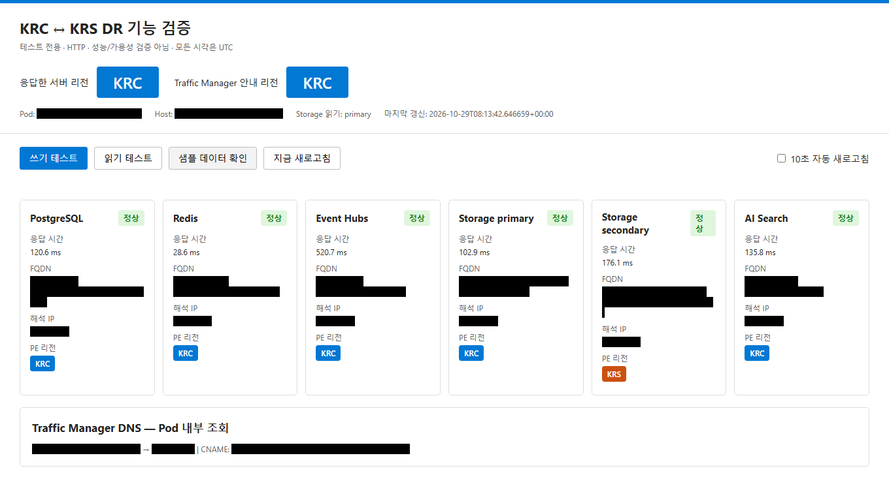
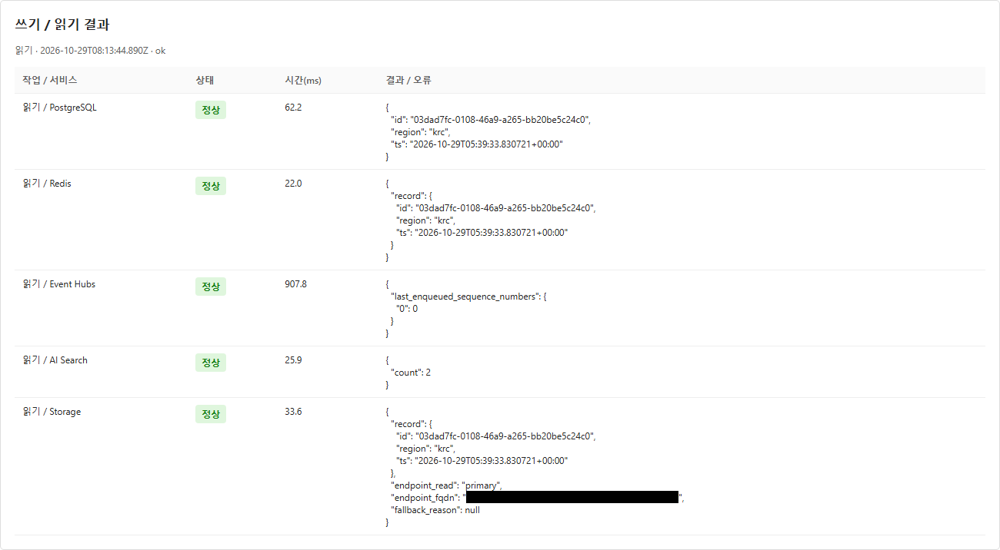
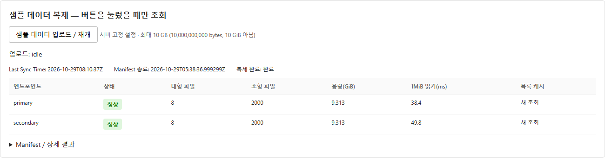

# 03. 앱 데이터와 샘플 복제 확인

[이전](02-ready.md) · [목차](README.md) · [다음: 포털 DR](04-dr-portal.md)

**실행 위치: PC의 앱 브라우저.** TM 주소 탭과 양 지역 탭을 유지합니다.

아래는 앱 화면 예시입니다. **리소스 이름·Pod 이름·IP·FQDN·접속 경로는 검은색으로 가렸습니다.**
UUID·UTC·응답 시간은 환경마다 다르므로 이미지의 값이 아니라 본인 실습에서 기록한 값으로 비교합니다.

## 1. 쓰기와 읽기

**앱 상태 화면:** 상단의 응답 서버 리전과 TM 안내 리전을 구분하고, 각 서비스의 상태와 PE 리전을 확인합니다.

1. TM 앱에서 **지금 새로고침**을 누르고 응답 지역과 서비스 상태를 확인합니다.
2. **쓰기 테스트**를 한 번 실행하여 UUID와 UTC를 기록합니다.
3. 다른 쓰기를 하지 않은 상태에서 **읽기 테스트**를 실행하여 Blob/PG의 동일 UUID를 비교합니다.
4. 활성화된 Redis/Search/EH 결과도 확인합니다. 일부 오류가 있으면 전체 성공으로 기록하지 않습니다.
5. 양 지역 앱에서도 서비스 접근을 확인합니다. PG는 writer alias, 일반 Blob은 primary hostname을 사용합니다.

**읽기 결과 예시:** PostgreSQL의 `id`와 Storage의 `record.id`를 쓰기 때 기록한 UUID와 비교합니다.
`endpoint_read`가 `primary`인지도 확인합니다. 화면은 읽기 결과이며 쓰기 성공 여부는 별도로 확인합니다.

EH의 일반 읽기는 sequence metadata이며 이벤트 본문 소비 증거가 아닙니다.
Search count는 비동기 반영될 수 있고, 양 지역 독립 인덱스가 자동 복제된다는 의미는 아닙니다.

## 2. 자동 생성 샘플 확인

**샘플 데이터 확인**을 누릅니다. 자동 배포가 이미 샘플을 생성하므로 다시 업로드할 필요는 없습니다.

| 확인 항목 | 완료 조건 |
|---|---|
| 데이터 파일 | large 8개와 small 2,000개, 총 2,008개 |
| payload 합계 | 정확히 10,000,000,000 bytes. 약 9.313 GiB 표시는 같은 값 |
| 양 endpoint inventory | 전체 파일 수·크기가 일치 |
| 보조 읽기 | 실제 secondary 파일 읽기 성공 |
| 복제 시점 | Last Sync Time이 최종 manifest 종료 시각 이상 |

**복제 확인 예시:** 양쪽 행의 파일 수·용량과 실제 읽기 결과를 확인하고,
상단의 Last Sync Time·Manifest 종료 시각·복제 완료 상태를 함께 비교합니다.

manifest/control JSON은 payload 수에 더하지 않습니다. `pending`/`null`/불일치/읽기 실패이면 DR를 시작하지 않습니다.
업로드 완료와 복제 완료는 서로 다르므로 최종 상태를 기다립니다.

## 3. 선택: 업로드 재개 체험

**샘플 데이터 업로드 / 재개**를 누르고 확인 창을 승인하면 서버에서 같은 layout을 재사용합니다.
PC 파일 업로드가 아닙니다. 잘못된 크기나 다른 manifest는 임의 삭제하지 않습니다.
HTTP 409이면 진행 중 작업을 관찰하고 중복 시작하지 않습니다.

완료 후 새 manifest 종료 시각 기준으로 복제를 다시 확인합니다. 샘플 목록은 300초 캐시이므로
재개 직후에는 최대 5분 뒤 다시 확인합니다. 화면 자동 새로고침이 샘플 목록을 계속 조회하지는 않습니다.

## 완료 조건

서비스별 실제 결과, UUID/UTC, 양 샘플 inventory, 보조 읽기와 복제 시점을 기록했습니다.
Storage `-secondary` 읽기는 이 단계의 복제 확인용이며 전환 후 일반 앱 읽기 경로가 아닙니다.

[다음: 포털 DR](04-dr-portal.md) · [Bash 대안](04-dr.md)