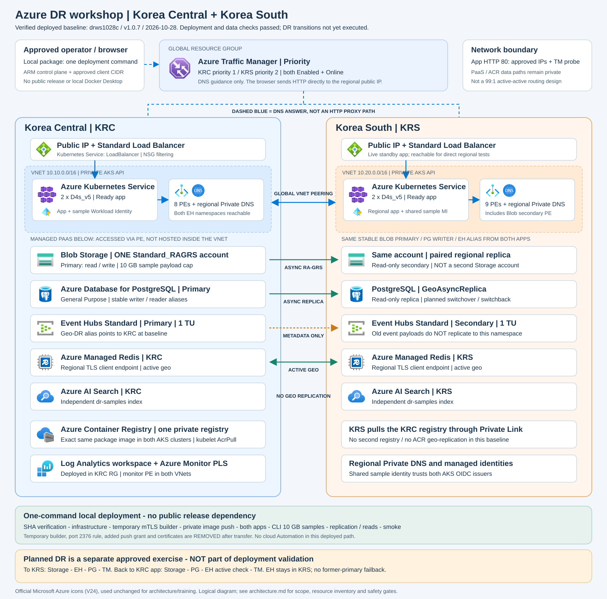

# Azure DR Workshop

Korea Central(KRC)·Korea South(KRS) 간 리소스와 앱을 배포하고, 데이터 확인부터
계획된 Failover·Failback·정리까지 진행하는 실습 프로젝트입니다.

## 시작하기

| 경로 | 안내 |
|---|---|
| 포털 기반 Step-by-Step | [고객용 워크숍](Portal_DeployToAzure_lab/workshop/README.md) |
| 기존 로컬 패키지 배포 | [배포 안내](workshop/local-package.md) |
| 서비스 구성과 DR 개념 | [아키텍처](workshop/architecture.md) |
| 기존 심화 실습 | [고급 과정](workshop/README.md) |
| 보안 주의사항과 게시 조건 | [보안 안내](SECURITY.md) |

포털 경로는 GitHub 버튼에서 Azure 포털 매개변수 화면으로 이동하고 리소스·앱·샘플을 자동 배포합니다.
운영 스크립트는 Bash에서 실행합니다. Cloud Shell 사용 범위와 장시간 DR 실행 환경은
[환경 준비](Portal_DeployToAzure_lab/workshop/00-environment.md)를 따릅니다.
기존 로컬 배포 경로도 유지합니다.

**현재 포털 버튼은 실환경 검증용 후보입니다.** 보안 수정과 최소 런타임을 포함한 v1.0.11 이미지·번들을
재빌드하고 v1.0.11-portal.2 템플릿에 SHA256을 고정했습니다. [검증 후보 상태](Portal_DeployToAzure_lab/releases/v1.0.11-portal.2/README.md)에 따라
실제 배포와 DR 검증이 필요합니다. 과거 로컬 v1.0.7의 결과를 현재 소스나 포털 경로의 성공으로 해석하지 않습니다.
2026-10-29 앱 이미지 감사에서 알려진 OS·Python 패키지 취약점이 없었습니다. 감사 범위와 한계는
[보안 안내](SECURITY.md)를 따릅니다. 취약점 항목 164개가 발견된 이전 v1.0.10 이미지는 계속 게시를 보류합니다.
공개된 예전 v1.0.3 버튼과 차단된 v1.0.6 계열 릴리스도 사용하지 않습니다.

## 구성과 실습 범위

| 구성 | 실습에서 확인할 차이 |
|---|---|
| 양 AKS 앱·Traffic Manager | 앱 응답 리전과 backend 역할을 구분. Priority 라우팅 사용 |
| Storage RA-GRS | 단일 계정, 복제·보조 읽기 확인, planned 계정 전환 |
| PostgreSQL | primary/geo-replica의 planned switchover와 writer alias |
| Event Hubs Standard | metadata-only Geo-DR. 이벤트 payload 복제나 자동 failback 아님 |
| Redis / AI Search | Redis active geo와 Search 독립 인덱스는 서로 다른 복구 방식 |

샘플 payload는 최대 **10 GB = 10,000,000,000 bytes**입니다.
ARM 배포 성공, 앱 준비 완료, 샘플 복제 완료는 별도 상태입니다.
실제 DR 전환·원복은 아직 실증하지 않았으며, SLA·RTO/RPO·성능 인증을 제공하지 않습니다.

## 실행 전 확인

- 승인된 구독·새 prefix·양 리전 용량·배포 및 RBAC 권한을 준비합니다.
- 앱 브라우저와 DR 실행 터미널의 출구 IP를 허용 목록에 포함합니다.
- 이 앱은 IP 제한 HTTP 진단 도구이며 사용자 인증이 없는 실습용입니다. 운영 데이터는 사용하지 않습니다.
- 암호·키·토큰·kubeconfig·개인 키·로컬 배포 상태는 GitHub에 올리지 않습니다.
- 생성된 리소스는 과금됩니다. 종료 날짜 태그는 자동 삭제나 비용 상한이 아닙니다.
- 실습 후 [정리 절차](Portal_DeployToAzure_lab/workshop/05-cleanup.md)에 따라 삭제 또는 유료 보관을 결정합니다.

기존 배포의 해시와 검증 범위는 [릴리스 기록](workshop/releases/v1.0.7-validation.md)에 있습니다.
실행 대상은 과거 기록의 환경이 아니라 이번에 승인한 구독·prefix·배포 출력이어야 합니다.